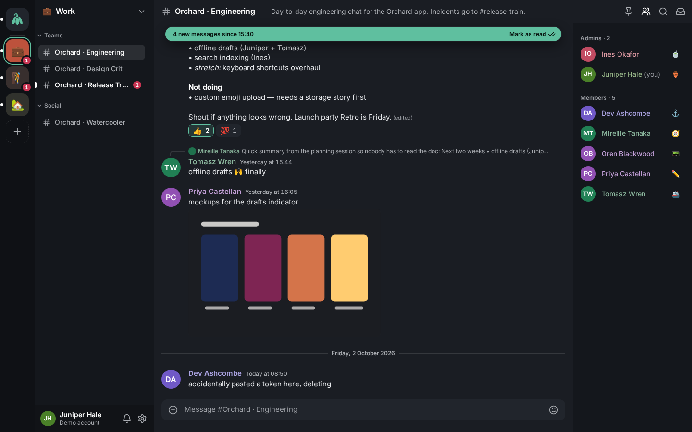
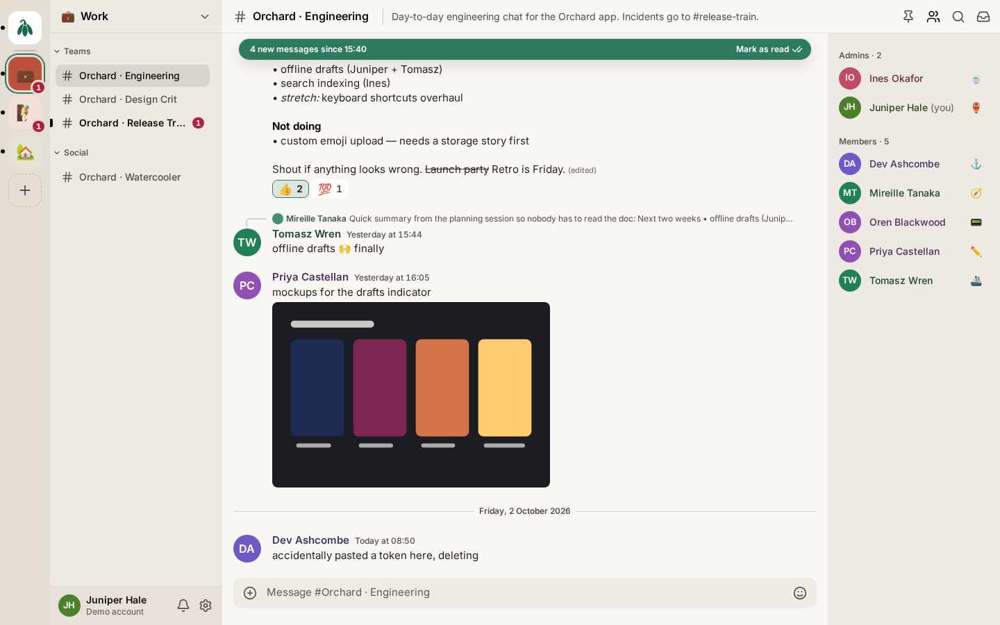
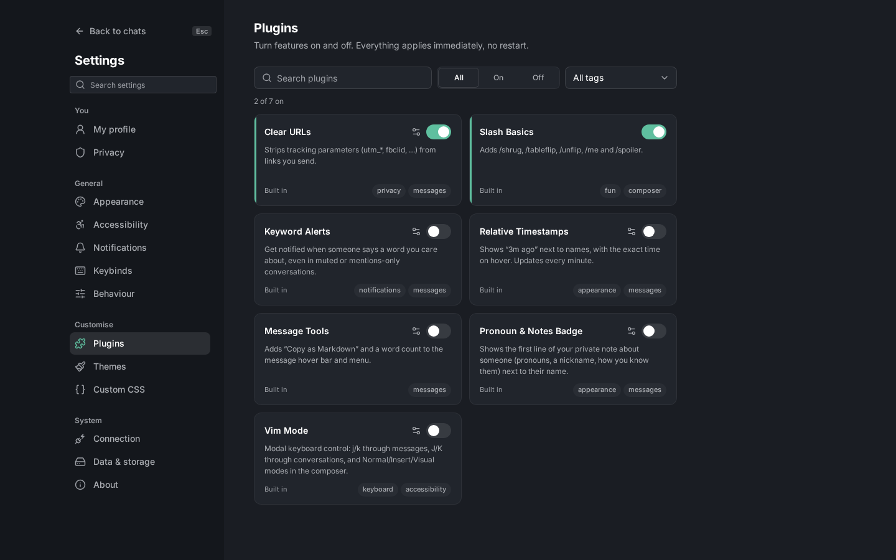

# Snowdrop

Snowdrop is a desktop-class chat client for the Signal network that runs in your
browser and talks to a local [signal-cli](https://github.com/AsamK/signal-cli)
daemon. It organises conversations the way community chat apps do (a rail of
spaces, a channel-style sidebar, the chat, a member list), with deep theming,
full keyboard control and a typed plugin system. It stays honest to Signal:
spaces, categories and folders are local organisation only, and it never
invents what the protocol can't back, such as online presence. Everything
stays on your machine.

It is named after the snowdrop, the small white flower that comes up through
the snow: quiet, fresh and early. The logo is a single nodding snowdrop, and
the default accent is the soft green on its inner petals.



## Highlights

- **Spaces, folders and categories.** Group your Signal conversations into
  local spaces on a rail, nest spaces in folders, and sort conversations into
  categories, all by drag and drop or from the keyboard.
- **A fast message list.** Virtualised and anchored to the bottom, with
  replies, reactions, edits, deletes, pins, attachments and a lightbox, a "new
  messages" divider, and search and a mentions inbox.
- **Native formatting.** Markdown in the composer becomes Signal's own body
  ranges (bold, italic, strikethrough, monospace, spoilers), so it shows up
  formatted on the official apps too. `@mentions`, `:emoji:` and `/commands`
  autocomplete.
- **Keyboard first.** A quick switcher (Ctrl/Cmd+K) for conversations, spaces
  and commands, rebindable shortcuts, and an optional Vim mode
  ([KEYBOARD.md](docs/KEYBOARD.md)).
- **Plugins.** Typed extension points for commands, slash commands, send
  transforms, message decorations, menus, styles, key layers and more,
  toggled live ([PLUGINS.md](docs/PLUGINS.md)).
- **Theming.** Four built-in themes (Dusk, Midnight, Linen, High Contrast),
  any accent colour, shareable theme files and Custom CSS on stable hooks
  ([THEMING.md](docs/THEMING.md)).
- **Reliable sync.** Optimistic sends with an outbox that survives reloads,
  resumable event streams, and local history in IndexedDB (signal-cli keeps
  none).
- **Accessible.** Keyboard-reachable everywhere, screen-reader labels and
  announcements, 4.5:1 text contrast in every built-in theme, reduced motion.

| Linen                                                 | Settings → Plugins                                                |
| ----------------------------------------------------- | ----------------------------------------------------------------- |
|  |  |

The screenshots show the built-in demo world; all people and messages in it
are fictional.

## Quick start

**Desktop app (recommended).** The Tauri-based desktop build bundles
signal-cli, so there is nothing to install or start first — build it (or get
a build) and link your Signal account on first launch. See
**[docs/DESKTOP.md](docs/DESKTOP.md)** for the dev and build commands, how
the bundled signal-cli works, and the security model. Today the bundle is
Linux x86_64 only; other platforms need signal-cli installed separately
(same doc, "Other platforms").

**Browser mode.** Runs entirely in a regular browser tab; good for trying
the demo, developing the UI, or connecting to a signal-cli daemon you manage
yourself. Requires Node.js 20 or newer:

```sh
npm install
npm run dev
```

Open the URL Vite prints (normally <http://localhost:5173>) and choose **Try
the demo**. The demo runs a seeded, fictional world entirely in the browser,
with simulated activity (people type, reply and react), so you can try
everything without a Signal account. Things to try:

- Press **Ctrl+K** (**⌘K** on macOS) and type a name, or `>` for commands.
- Right-click (or Shift+F10 on) a conversation, a space or a message.
- Drag a space onto another to make a folder.
- Open **Settings** (**Ctrl+,**) → Appearance or Themes, and switch themes.
- Turn on **Vim Mode** in Settings → Plugins and press `?`.
- Press **Ctrl+/** for every shortcut.

Your choice is remembered; switch between the demo and signal-cli in
**Settings → Connection**.

## Connecting to signal-cli (browser mode)

In browser mode, to use your real Signal account, run signal-cli as a local
HTTP daemon and choose **Connect to signal-cli** on the welcome screen:

```sh
signal-cli daemon --http 127.0.0.1:8080 --receive-mode on-connection
npm run dev        # proxies /signal-cli → http://127.0.0.1:8080
```

Snowdrop can link itself as a new device (scan a QR code with the Signal app).
Read **[docs/SIGNAL_CLI.md](docs/SIGNAL_CLI.md)** first: it covers installation,
single- and multi-account daemons, linking, what to expect (history starts
when Snowdrop first connects) and troubleshooting. Keep the daemon on
`127.0.0.1`: it has no authentication. The desktop app needs none of this —
see [docs/DESKTOP.md](docs/DESKTOP.md).

## Scripts

| Command                         | What it does                                                                             |
| ------------------------------- | ---------------------------------------------------------------------------------------- |
| `npm run dev`                   | Vite dev server with hot reload and the signal-cli proxy.                                |
| `npm run build`                 | Type-checks (`tsc -b`) and builds to `dist/` (with CSP and `THIRD_PARTY_NOTICES.txt`).   |
| `npm run preview`               | Serves the production build locally, with the same proxy.                                |
| `npm run typecheck`             | TypeScript only, no output.                                                              |
| `npm run lint`                  | ESLint, then `scripts/verify-boundaries.mjs` (proves the architecture rules still fire). |
| `npm test`                      | All Vitest suites once.                                                                  |
| `npm run test:watch`            | Vitest in watch mode.                                                                    |
| `npm run format`                | Prettier, writing changes.                                                               |
| `npm run format:check`          | Prettier, check only.                                                                    |
| `node scripts/gen-licences.mjs` | Regenerates the About page's licence list after dependency changes (then run Prettier).  |
| `npm run tauri:fetch`           | Downloads and verifies the pinned signal-cli sidecar for the desktop app.                |
| `npm run tauri:dev`             | Fetches the sidecar, then runs the desktop app in dev mode.                              |
| `npm run tauri:build`           | Fetches the sidecar, then builds the desktop app (AppImage, .deb).                       |

The full quality gate is
`npm run typecheck && npm run lint && npm test && npm run build`. See
[docs/DESKTOP.md](docs/DESKTOP.md) for the desktop app's own build and gates.

Environment: `SNOWDROP_SIGNAL_CLI_URL` (shell or `.env.local`) points the dev
and preview proxy at a daemon other than `http://127.0.0.1:8080`.

## Project structure

```text
src/
  main.tsx            entry: safe mode, dev tools, mounts <App>
  app/                composition root: createSnowdrop, lazy backend/repository, providers
  core/               no React allowed
    domain/           pure types and helpers (markdown → Signal ranges, grouping, fuzzy)
    lib/              leaf utilities (emitter, clock/scheduler, disposables, observable lists)
    backend/          ChatBackend contract; mock/ (demo world) and signal-cli/ adapters
    persistence/      message repository (memory, IndexedDB), versioned settings storage
    stores/           zustand vanilla stores
    services/         sync engine, send pipeline, history paging, notifications
    commands/         command registry, keybinds, key layers
    plugins/          plugin runtime, extension registries, headless built-in plugins
    themes/           tokens, built-in themes, theme engine, CSS sanitiser
  ui/
    primitives/       presentational components (menus, dialogs, slots…)
    hooks/            React context and shared hooks
    features/         rail, sidebar, chat, members, settings, switcher, onboarding,
                      spaces, conversation, shell
    plugins/          built-in plugins with UI (incl. vim/)
    styles/           tokens.css (the Dusk theme), global.css, reset.css
  test/               test helpers and app-level tests
devserver/            Vite plugins: CSP, signal-cli proxy guard, local emoji data, notices
scripts/              verify-boundaries.mjs, gen-licences.mjs
docs/                 documentation
```

## Documentation

- [DESKTOP.md](docs/DESKTOP.md) — the Tauri desktop app: dev/build, the
  bundled signal-cli sidecar, the transport layer, and the security model.
- [ARCHITECTURE.md](docs/ARCHITECTURE.md) — layers and boundaries, data flow,
  persistence, adding a backend adapter, testing.
- [PLUGINS.md](docs/PLUGINS.md) — the plugin author guide.
- [THEMING.md](docs/THEMING.md) — tokens, theme files, Custom CSS, the CSS
  security policy, safe mode.
- [KEYBOARD.md](docs/KEYBOARD.md) — every shortcut, and Vim mode.
- [SIGNAL_CLI.md](docs/SIGNAL_CLI.md) — running Snowdrop against signal-cli.
- [PLAN.md](docs/PLAN.md) — the product plan, delivery status and the
  as-built record of decisions (§8).

## Privacy

- **Local only.** Snowdrop has no server of its own and no telemetry. It talks
  to nothing but your signal-cli daemon, through a same-origin proxy that only
  answers the app itself on a loopback address.
- **No CDNs.** Fonts (Inter, JetBrains Mono) and emoji data are bundled and
  served from Snowdrop's own origin. Link previews are off.
- **Content-Security-Policy.** Production builds forbid every third-party
  request (`default-src 'self'`, `connect-src 'self'`).
- **User CSS can't phone home.** Custom CSS and imported themes are stripped
  of any remote reference before they apply ([THEMING.md](docs/THEMING.md)).
- **Your data stays in your browser.** Message history is stored in IndexedDB
  and settings in local storage for the Snowdrop origin; export or clear them in
  Settings → Data & storage.

## Legal

Inspired by Discord's layout. Not affiliated with or endorsed by Signal or Discord.

## Licence

[MIT](LICENSE) © 2026 nightxade. The desktop build bundles
[signal-cli](https://github.com/AsamK/signal-cli) (GPL-3.0) as a separate
program; see `docs/DESKTOP.md` and the About page for its licence notice.
