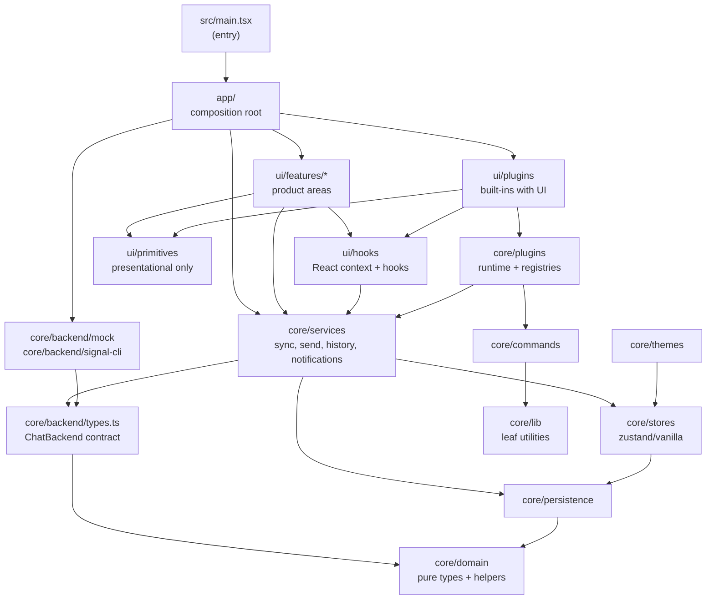
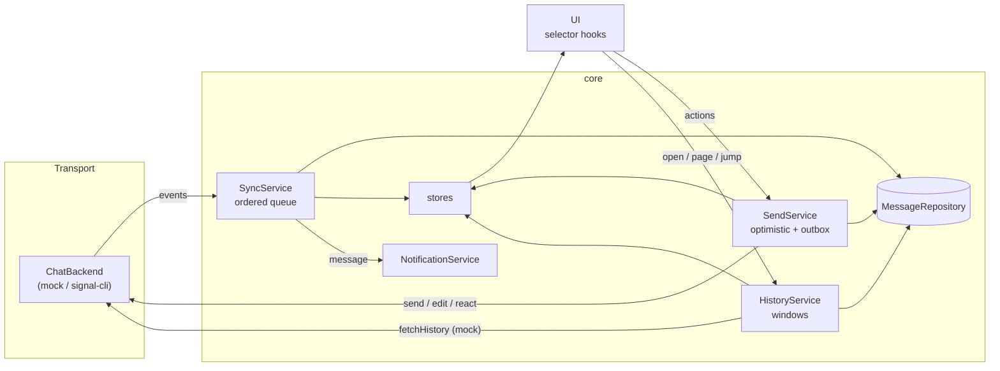

# Architecture

Snowdrop is a single-page React app over a React-free core. The core owns the
domain model, the transport contract, state, persistence and every rule about
messages (ordering, read state, optimistic sends, plugins). The UI only reads
stores and calls services. One function, `createSnowdrop` in
`src/app/createSnowdrop.ts`, wires everything together and is the only place
that knows which transport is in use.

This page explains the layers, how data moves through them, and how to extend
the system with a new transport. The plugin API is in [PLUGINS.md](PLUGINS.md),
theming in [THEMING.md](THEMING.md), and the build history and design decisions
in [PLAN.md](PLAN.md) §8.

## Layers and dependency rules



An arrow means "may import". Arrows are transitive downwards (a feature may
also import `core/domain`, `core/stores`, `core/themes`…); the diagram shows
the main edges, not every one.

| Layer                     | Responsibility                                                                                                                                   |
| ------------------------- | ------------------------------------------------------------------------------------------------------------------------------------------------ |
| `core/lib`                | Typed `Emitter`, `Clock`/`Scheduler` (+ `ManualScheduler` for tests), `DisposableStore`, `ObservableList`, nonces.                               |
| `core/domain`             | Pure types (`Message`, `Conversation`, `Contact`…) and pure helpers (markdown → ranges, grouping, fuzzy, ids).                                   |
| `core/backend/types.ts`   | The `ChatBackend` contract, `BackendEvents`, and `BackendKind` (an open set of registered kinds).                                                |
| `core/backend/mock`       | Seeded demo world with simulated activity.                                                                                                       |
| `core/backend/signal-cli` | JSON-RPC over HTTP + SSE adapter for a local signal-cli daemon ([SIGNAL_CLI.md](SIGNAL_CLI.md)).                                                 |
| `core/persistence`        | `MessageRepository` (memory and IndexedDB), versioned key-value settings storage.                                                                |
| `core/stores`             | zustand vanilla stores, one slice per file, plus memoised selectors.                                                                             |
| `core/services`           | `SyncService`, `SendService`, `HistoryService`, `NotificationService`, `ReceiptBuffer`, history export.                                          |
| `core/commands`           | `CommandRegistry`, keybind parsing/matching (`KeybindDispatcher`), key layers (`KeyLayerStack`), core command ids.                               |
| `core/plugins`            | `PluginRuntime`, `Registries` (extension points), settings schemas, headless built-in plugins.                                                   |
| `core/themes`             | Token names, built-in themes, the theme engine, the CSS sanitiser, theme import/export.                                                          |
| `ui/primitives`           | Buttons, menus, dialogs, `Slot`/`PluginBoundary`… Thin wrappers over Radix, cmdk, frimousse, dnd-kit, sonner.                                    |
| `ui/hooks`                | `useSnowdrop()` (`AppServices`), `useObservableList`, layout state, roving focus, focus targets, text surfaces.                                  |
| `ui/features/*`           | One folder per product area: `rail`, `sidebar`, `chat`, `members`, `settings`, `switcher`, `onboarding`, `spaces`, `conversation`, `shell`.      |
| `ui/plugins`              | Built-in plugins that render UI (Relative Timestamps, Message Tools, Pronoun & Notes Badge, Vim Mode, Keyword Alerts' UI half).                  |
| `ui/styles`               | `tokens.css` (the Dusk base theme), `global.css`, `reset.css`.                                                                                   |
| `app`                     | `createSnowdrop`, the backend registry (`backends.ts`), the plugin host (`pluginHost.ts`), core commands, `deferredBackend`/`Repository`, `App`. |

### The rules

These are enforced on every source file by `eslint.config.js`
(`import-x/no-restricted-paths` zones plus `no-restricted-imports`):

1. `core/**` must not import `ui/**` or `app/**`, nor `react`, `react-dom` or
   React-bound zustand entry points. Stores use `zustand/vanilla`, so services
   and plugins run headless (tests, workers).
2. `core/domain` and `core/lib` are leaves: they import nothing else from
   `core`.
3. `ui/primitives` must not import `ui/features`, `core/**` or `app/**`. They
   are pure presentational components.
4. A feature (`ui/features/<name>/**`) may import another feature only through
   that feature's `index.ts`.
5. `ui/hooks` must not import `ui/features` or `ui/plugins` (they build on
   it). `ui/plugins` may import `core`, `ui/primitives`, `ui/hooks` and a
   feature's `index.ts`, never a feature's internals or `app/`.
6. The adapters under `core/backend/mock` and `core/backend/signal-cli` may
   only be imported by `app/` (the composition root); not by `ui/`, the rest
   of `core/`, or top-level files such as `src/main.tsx`. Test files may
   import the mock directly.
7. Named exports only (`no-restricted-syntax` on `export default`), and no
   import cycles (`import-x/no-cycle`).

`ui/features` and `ui/plugins` reach the composed app through
`AppServices` (declared in `ui/hooks/SnowdropContext.tsx`), which the concrete
`Snowdrop` satisfies structurally. That keeps features from importing `app/`.

### How lint proves the rules still fire

A boundary rule that silently stops matching (a resolver change, a typo in a
glob) is worse than no rule. `npm run lint` therefore runs
`eslint . && node scripts/verify-boundaries.mjs`. The script writes small,
uniquely named fixture files (`__boundary_<pid>_<n>__.ts`) into each layer,
lints them with the real config, and fails unless each produces exactly the
expected rule ids. For example, `core/domain` importing `@/core/services` must
report `import-x/no-restricted-paths`; `core/services` importing `react` must
report `no-restricted-imports`; `ui/features/rail` importing `../sidebar` (the
index) must be clean. Fixtures are new files only, never existing ones, and are
removed on exit, on SIGINT/SIGTERM and at the next start. When you add a
layer or a rule, add a case to the `cases` table in that script.

## The composition root

`createSnowdrop(options)` (synchronous) builds one instance:

1. Loads persisted state with `loadVersioned` and creates the stores
   (`createStores`), then binds them back to storage with `bindPersistence`
   (the `local` store is debounced: drafts change per keystroke).
2. Picks the transport from `settings.connection.backend`, **once per
   instance**, by looking it up in the backend registry (`app/backends.ts`;
   the default, before the user has chosen, is `mock`). Switching transport
   means a new instance: `main.tsx` reloads the page (`App`'s
   `onBackendChange`). The registration says where history lives:
   - `mock`: in memory, because the demo world is regenerated relative to
     "now" on each launch.
   - `signal-cli`: IndexedDB (`snowdrop-signal-cli`), because the daemon keeps
     no history. Falls back to memory when IndexedDB is missing.

   The settings are parsed against the registry too
   (`createSettingsSchema({ isBackendKind })`): a stored kind this build
   doesn't register reads as "not chosen", so the welcome screen shows.

3. Creates `Registries`, `SendService`, `SyncService` and `HistoryService`
   with explicit dependencies (backend, repository, stores, clock, scheduler,
   a shared `ReceiptBuffer`, an error reporter).
4. Creates the `PluginRuntime` with `withUiPlugins(BUILTIN_PLUGINS)` and a
   `PluginHost` (`pluginHost.ts`: stores, a narrow backend facade, message
   actions, toasts, error reporting). `Registries`' error handler logs plugin
   failures and records them on the plugin (`reportRuntimeError`), so its card
   shows them with Retry.
5. Creates `NotificationService` (fed by `sync.on('message')`, boosted by
   `registries.boostReason`) and the `KeybindDispatcher`.
6. Registers the core commands that need no view state (`coreCommands.ts`:
   switcher, settings, shortcuts, member list, mark read, spaces, theme
   commands…). Commands that need view order are registered by the UI against
   the same ids (`useCoreCommands`, `useChatCommands`).
7. When given a `document`, applies appearance (`applyAppearance`) and
   re-applies it when appearance settings, Custom CSS, custom themes or plugin
   styles change. Safe mode passes empty Custom CSS and no imported themes.

`snowdrop.start()` then connects and runs the initial sync, restores the outbox,
runs the registration's `onStarted` (the demo seeds its spaces, once), starts
plugins and notifications, and wires the registration's `attach` (the demo's
liveliness switch). A
failed start (e.g. signal-cli has no account yet) can simply be retried.
`flush()` writes debounced state (called on `pagehide` and before reloads);
`dispose()` tears everything down.

### Lazy adapters: `deferredBackend` and `deferredRepository`

Each adapter is its own chunk, loaded by its registration's `load()` (a
dynamic `import()`). Services are wired synchronously, so `connectBackend`
hands them a `deferredBackend(kind, capabilities, ready)`: a `ChatBackend`
whose async methods await the adapter, whose `on()` subscriptions made early
attach once it loads, and whose `getStatus()` reports `connecting` until
then. Some code checks _which optional methods exist_ up front
(`SendService.capabilities`, the UI's `resolveAttachmentUrl` check), so each
registration declares its `capabilities`; a test in `deferredBackend.test.ts`
loads every registered adapter and fails if the declaration drifts from it.

`deferredRepository(ready)` does the same for `IdbMessageRepository.open()`:
a `Proxy` that awaits the real repository before forwarding each call.

## Data flow



The UI never subscribes to the backend. It reads stores through selector hooks
and calls services (or runs commands).

### Incoming: backend events → SyncService → repository and stores

Adapters translate protocol quirks into the domain-level `BackendEvents`
(`message`, `messageEdited`, `messageDeleted`, `messagePinned`, `reaction`,
`receipt`, `typing`, `readSync`, `conversationUpdated`, `contactUpdated`,
`status`, `checkpoint`). `SyncService` subscribes once:

- **Ephemeral events apply immediately:** `status`, `typing` and
  `contactUpdated` go straight to their stores.
- **Everything else goes through one ordered queue,** so an edit can never
  overtake the message it edits and a group refresh can't be overtaken by the
  next message. A handler that throws is reported and skipped; it never stalls
  the queue.
- **The queue is gated on the initial sync.** While `start()` loads self,
  contacts, conversations and read cursors (and, for the mock, seeds the newest
  history page per conversation), incoming events are parked in a backlog and
  replayed afterwards against real read cursors, so messages that arrived while
  the app was closed count as unread. The backlog survives a failed start.
- **A message** is upserted with `mergeDuplicate` (re-deliveries merge, never
  duplicate), appended to windows anchored to the present
  (`messages.appendLive`), bumps conversation activity and the sidebar preview
  (`conversations.noteLatest`), clears that author's typing state and, if new,
  updates unread/mention counts and emits `sync.on('message')` (feeds
  `NotificationService`) and `sync.on('messageArrived')` with `live: false`
  for messages parked behind the initial sync (feeds plugins'
  `ctx.backend.onMessage`). A re-delivery neither re-counts nor re-notifies.
- Edits older than the stored edit are ignored; deletes, pins and reactions
  update the stored row and the loaded window in place; receipts only ever
  advance status (`advanceStatus`); disappearing messages are purged on a timer
  and remembered as tombstones so a replay can't resurrect them.

### Ordering: `seq`, not timestamps

`(authorId, sentAt)` is a Signal message's **identity**
(`MessageId = "<authorId>:<sentAt>"`), but sender clocks can be wrong. Every
stored message therefore gets `seq`, a local, monotonically increasing arrival
sequence assigned by the repository:

- `upsert` gives a new message the next seq; merged duplicates keep theirs.
- Backfilled (older) history gets seqs _below_ everything stored
  (`upsertMany(…, { backfill: true })`).
- Optimistic sends reserve a seq with `allocateSeq()` so they keep their
  place when acknowledged.

The timeline, the repository index, read cursors, unread counts, the "new
messages" divider and conversation activity all use local arrival, so a sender
with a skewed clock can't bury a new message.

### Checkpoints and acknowledgements

Transports that can resume emit `checkpoint { cursor }` after each unit of
work (signal-cli: after the events produced by each SSE event). `SyncService` queues the
checkpoint like any other event, so it runs only after every preceding
repository write, and then calls `backend.acknowledge(cursor)`. Only then does
the signal-cli adapter persist the transport's cursor
(`snowdrop.signal-cli.cursor.<resumeScope>.<account>`; the SSE event id in a
browser, a desktop session cursor in the Tauri app — see "The transport layer
and `src/platform`" below). A crash or reload therefore
re-delivers rather than skips; re-delivery is deduplicated by the merge. Events
dropped by `stop()` are never acknowledged. `deferredBackend` buffers
acknowledgements made before the adapter has loaded.

### Outgoing: the send pipeline

`SendService.send(draft)` takes an `OutgoingDraft` (raw composer text with a
U+FFFC per mention, the mention ids, quote, attachments, optional `format`):

1. **Transforms.** `registries.transform(draft)` runs plugin send transforms
   in registration order. A transform that throws, or returns something that
   isn't a valid draft for the same conversation (`isValidDraft`), is skipped.
2. **Compose.** Markdown (per `format`, else the user's setting) becomes
   Signal body + style ranges (`parseMarkdownToRanges`), and mention ids are
   attached to the placeholders (`attachMentions`).
3. **Optimistic row.** The message appears immediately as
   `pending:<nonce>` with a reserved seq, and is staged in the repository with
   an outbox entry (`stageOutgoing`). A reload restores outbox entries as
   _failed_ (`restoreOutbox`), so typed text is never lost.
4. **Transport.** `backend.send()` resolves with a `SendResult` (`sentAt`,
   optional resolved attachments, per-recipient failures). On error the row
   becomes `failed` (Retry / Delete in the UI; `send.retry`, `send.discard`).
5. **Reconcile.** The row is committed under its real id `<self>:<sentAt>`
   (`commitOutgoing`, merged with any sync echo that landed first). The
   `nonce` is kept so render keys stay stable across the id swap.
6. **Receipts that beat the ack.** Receipts can arrive before `send()`
   resolves. They are held in the shared `ReceiptBuffer` (60 s) and applied at
   reconcile.
7. **Queued operations.** Editing, reacting to or deleting a still-pending
   message shows the effect at once and replays the backend call against the
   real id after acknowledgement. On a failed (never sent) message an edit
   rewrites the outgoing input and a delete discards it.

`edit`, `react`/`toggleReaction`, `deleteForEveryone`, `adminDelete` and `pin`
follow the same optimistic shape (apply to the store, call the backend,
persist or revert); `deleteForMe` is local only. `setTyping` is best-effort:
it is sent at most every 10 s (`TYPING_REFRESH_MS`) and only when the user's
"Send typing indicators" setting and every plugin typing guard
(`registries.allowsTyping`) allow it. `send.capabilities` reports which
optional operations (`pin`, `adminDelete`) the transport supports.

### Reading: HistoryService and conversation windows

The repository is the source of truth; the messages store holds **windows**
onto it, one per conversation (`ConversationWindow`: `ids`, `byId`,
`hasMoreBefore`, `hasMoreAfter`, `anchoredToPresent`, `loading`, `loaded`),
capped at `WINDOW_CAP` (400) with eviction on the side far from the reader.

- `open(id)` snapshots the read cursor into `ui.unreadMarkers` (so the "new"
  divider doesn't move while auto-mark-read runs) and loads the newest page.
- `loadOlder` / `loadNewer` page from the repository; when local history runs
  out and the backend implements `fetchHistory` (only the mock), older pages
  are backfilled from it.
- `jumpTo(id)`, `jumpToFirstUnread`, `jumpToPresent` replace the window with
  one around the target; a window that isn't anchored to the present is
  _detached_ and live messages don't append to it (the UI jumps to present
  before sending).
- Paging coalesces with an in-flight page; a jump bumps a generation token
  that discards results of whatever was in flight. A load that ends anchored to
  the present catches up on messages stored meanwhile.
- In-place updates keep `ids` identity, so `createRenderItemsSelector`
  recomputes layout (`groupMessages`: day dividers, new divider, author groups)
  only when ids or the marker change; rows subscribe per message id.

**Read state.** A conversation is marked read only when its window is
anchored, its bottom is visible (`ui.scrolledUp[id]` is unset) and the window is
focused (`useReadTracking` in the list). `SyncService` applies the same rule
when deciding whether a new message is unread.

## Persistence

| What                                                                            | Where                                                                                       |
| ------------------------------------------------------------------------------- | ------------------------------------------------------------------------------------------- |
| Settings (`snowdrop.settings`, v3)                                              | `localStorage` via `loadVersioned` / `bindPersistence`                                      |
| Spaces, folders, categories (`snowdrop.spaces`)                                 | same                                                                                        |
| Pin / mute / archive / drafts, contact notes, reaction usage (`snowdrop.local`) | same, debounced                                                                             |
| Messages, read cursors, outbox                                                  | `MessageRepository`: memory for the demo, IndexedDB `snowdrop-signal-cli` for signal-cli    |
| signal-cli resume position and DM peers                                         | `snowdrop.signal-cli.cursor.<resumeScope>.<account>`, `snowdrop.signal-cli.peers.<account>` |

Versioned data is stored as `{ v, data }`. Loading runs step-wise migrations,
then parses **field by field** against defaults, so one corrupt field falls back
alone; unusable data is copied to `<key>.backup` before defaults take over.
Protocol state (`Conversation`) and device-local state
(`LocalConversationState` in the `local` store) are separate, so a backend
update can never clobber a pin or mute; `ConversationView` combines them in
memoised selectors (`stores/views.ts`).

## How to add a backend adapter

A new transport (say, `matrix-bridge`) is a folder under `core/backend/` that
implements `ChatBackend`, plus **one registration**. Nothing above the
contract changes: settings parsing, `deferredBackend`, Settings → Connection
and plugins' `ctx.backend.kind` all read the registry.

1. **Create the folder** `src/core/backend/<kind>/` with an `index.ts` that
   exports the adapter class. Import only `@/core/domain`, `@/core/lib` and the
   contract types from `@/core/backend`. Its `kind` is your kind string
   (`/^[a-z][a-z0-9-]{0,31}$/`).
2. **Register it** in `BUILTIN_BACKENDS` (`src/app/backends.ts`):

   ```ts
   const matrixBackend: BackendRegistration = {
     kind: 'matrix-bridge',
     label: 'Matrix bridge',
     description: 'Signal rooms through a Matrix bridge.',
     load: () =>
       import('@/core/backend/matrix-bridge').then(
         ({ MatrixBackend }) =>
           (env) =>
             new MatrixBackend({
               clock: env.clock,
               scheduler: env.scheduler,
               storage: env.storage,
             }),
       ),
     capabilities: new Set(['fetchHistory']), // exactly the optional methods it implements
     history: { kind: 'memory' }, // or { kind: 'indexeddb', name: 'snowdrop-matrix' } if the transport keeps none
   };
   ```

   `env` (`BackendEnvironment`) carries the clock, scheduler, key-value
   storage, the persisted connection settings and `updateConnection` for
   settings the adapter discovers. Optional hooks: `onStarted` (after the
   first successful start) and `attach` (wiring for the instance's lifetime;
   returns its cleanup). `settingsSchema` is reserved for adapter-specific
   options.

3. **Keep it behind the boundary:** add the folder name to the `adapterZones`
   list in `eslint.config.js` (currently `['mock', 'signal-cli']`) so only
   `app/` may import it.
4. **Test it** headless: drive it with a fake transport (see
   `core/backend/signal-cli/testing.ts` for a scriptable fake daemon) and boot
   it through `createSnowdrop` with injected fakes (see
   `src/app/createSnowdrop.signalCli.test.ts`, and `src/app/backends.test.ts`,
   which boots a newly registered kind). `deferredBackend.test.ts` checks the
   declared `capabilities` against the loaded adapter automatically.

Settings → Connection lists the registered kinds. Connection fields specific
to one transport (signal-cli's daemon address and account) and the welcome
screen's two buttons are still written for the built-in transports; a new
adapter with its own options adds them there.

### Contract checklist

- [ ] **Identity.** `Message.id` is `messageId(authorId, sentAt)`; every alias of
      the local account (number, UUID) maps to one self id; `Contact.id` is
      stable across sessions.
- [ ] **`send()`** resolves with the timestamp the network assigned
      (`SendResult.sentAt`); throws when nobody received the message; reports
      partial group failures in `recipientFailures` instead of throwing.
- [ ] **Own messages from other devices** arrive as `message` events with
      `authorId` = self (status `sent`); incoming messages have status `read`.
- [ ] **Edits** emit `messageEdited` with the _original_ `targetSentAt`;
      **deletes** emit `messageDeleted` (`deletedBy` for admin deletes).
- [ ] **Receipts** are for messages _we_ sent; `authorId` is the recipient.
- [ ] **Read on another device** emits `readSync` with message refs only (the
      sync engine resolves conversations).
- [ ] **A new conversation** is announced with `conversationUpdated` before its
      first message (the sync engine also synthesises unknown DMs).
- [ ] **Status** goes `connecting` → `online`, `offline` on retries, `error`
      when the connection is refused for good.
- [ ] **Ordering.** Emit events in protocol order; if one input produces several
      events (e.g. a group update → system line + `conversationUpdated`), emit
      them through one internal queue.
- [ ] **Resumable transports** emit `checkpoint` after each unit of work and
      persist the position only in `acknowledge()`; re-delivery must be safe.
- [ ] **Attachments** either carry a renderable `url`, or the adapter implements
      `resolveAttachmentUrl` and returns `blob:` URLs typed with their real type
      only for allow-listed raster image/audio/video types (never SVG or HTML).
- [ ] **Optional methods** (`fetchHistory`, `adminDelete`, `pinMessage`,
      `updateConversation`, `resolveAttachmentUrl`, `acknowledge`, `link`) are
      either implemented properly or absent, and match the registration's
      `capabilities`.
- [ ] **Errors** carry a string `kind` (duck-typed into `session.errorKind`), so
      the UI can show onboarding states like signal-cli's `no-account`.
- [ ] **`on()`** returns an unsubscribe; listener errors never break the
      adapter (use `Emitter` from `core/lib`).
- [ ] **No raw protocol objects** leave the adapter; validate untrusted input at
      the boundary (`unknown` + narrowing, see `signal-cli/validate.ts`).

### Future: opaque message ids

Message identity is Signal's `(authorId, sentAt)` all the way through the
contract (`MessageId = "<authorId>:<sentAt>"`, built by `messageId()`). A
transport whose messages have opaque ids (Matrix event ids, say) can't fill
those fields honestly. The plan is a `MessageRef` at the contract boundary,

```ts
interface MessageRef {
  id: MessageId; // always set: the stored message's id
  authorId?: string; // Signal-style transports
  sentAt?: number;
}
```

with each adapter mapping it to its native identity. It was deliberately not
done in P6: it touches every adapter, both services and most of their tests.
Every touch point:

- **Contract (`core/backend/types.ts`).** `deleteForEveryone(conv, sentAt)`;
  `adminDelete(conv, MessageRef)` and `markRead(conv, MessageRef[])` (today's
  `MessageRef` is `{ authorId, sentAt }`); `EditInput.targetSentAt`;
  `ReactInput` / `PinInput` `targetAuthorId` + `targetSentAt`; events
  `messageEdited` / `messageDeleted` (`authorId` + `targetSentAt`),
  `messagePinned` / `reaction` (`targetAuthorId` + `targetSentAt`),
  `receipt.sentAts` (resolved via `messageId(self, sentAt)`), `readSync.messages`;
  `SendResult.sentAt` (the new message's identity) and `HistoryQuery.before`
  (a `sentAt` cursor).
- **`SyncService`.** Every handler rebuilds ids with `messageId(e.authorId,
e.targetSentAt)`; `onReceipt` maps `sentAts` to our own ids; `onReadSync`
  resolves refs to conversations; read cursors and `markRead` send refs built
  from stored messages.
- **`SendService`.** Commits optimistic rows as `messageId(self,
result.sentAt)`; `edit` / `react` / `deleteForEveryone` / `pin` /
  `adminDelete` pass `real.authorId` / `real.sentAt`; queued operations on
  pending rows replay against the acknowledged `(self, sentAt)`;
  `ReceiptBuffer` is keyed by `sentAt`.
- **`HistoryService`** pages with `before: sentAt`.
- **Adapters.** The mock's world and liveliness, signal-cli's normaliser
  (`normalise/envelope.ts`), `params.ts` (`targetTimestamp`,
  `targetAuthor`, `quoteTimestamp`) and `SignalCliBackend`'s edit/react/delete/
  pin/markRead.
- **Domain.** `Message.sentAt` stays (display and ordering fallback), but
  identity would be `Message.id` alone; `Quote` references `(authorId,
sentAt)` too.
- **Tests.** `services.test.ts`, `races.test.ts`, the signal-cli backend and
  normaliser suites and `MockBackend.test.ts` construct refs directly.

Migration order that keeps the suite green at each step: add `id` to the
contract types alongside the Signal fields (adapters fill both); switch the
services to read `id`; then make `authorId` / `sentAt` optional and let new
adapters omit them.

## The transport layer and `src/platform`

`core/backend/signal-cli` talks to signal-cli through a small seam,
`SignalCliTransport` (`core/backend/signal-cli/transport.ts`): `check`,
`request`, `subscribe`, an optional `acknowledge`, a `resumeScope` (scopes
persisted resume cursors, below) and a `description` for error messages.
`JsonRpcClient` (`rpc.ts`) runs over any transport and enforces its own
timeouts, so a transport that can't cancel still times out. Two
implementations exist:

- **`HttpTransport`** (`httpTransport.ts`) — the browser build. `POST
/api/v1/rpc` and `GET /api/v1/events` (Server-Sent Events, resumable with
  `Last-Event-ID`) through the dev/preview proxy.
- **`TauriTransport`** (`src/platform/tauri/TauriTransport.ts`) — the desktop
  build. Requests become Tauri command invocations; incoming events and
  stream state arrive as Tauri events. The Rust side owns the signal-cli
  process (or a proxied external daemon) and holds forwarded events until
  acknowledged, since neither a child process nor Signal's own delivery gives
  it a daemon-style event id to resume from. Full detail, including the
  cursor format, is in [DESKTOP.md](DESKTOP.md).

`src/platform/` is where anything Tauri-specific lives, kept out of `core/`
and `ui/`:

- `platform/detect.ts` exports `isTauri()` and imports nothing from Tauri, so
  it's safe to call from anywhere.
- `platform/tauri/` holds `ipc.ts` (the only `@tauri-apps/api` import),
  `TauriTransport.ts`, `notifications.ts` (native notifications via
  `tauri-plugin-notification`), `links.ts` (external links via the
  `open_external` command) and `desktop.ts` (the `DesktopAdmin` used by
  Settings → Connection and About).
- `app/backends.ts` picks `TauriTransport` over `HttpTransport` when
  `isTauri()` is true, through a dynamic `import('@/platform/tauri')`.
  `app/platform.ts` wires lazy native notifications, the desktop admin, and
  link handling into `AppServices.desktop`.

**Lint boundary.** `eslint.config.js`'s `platformZones` (checked by
`import-x/no-restricted-paths`, with cases in `verify-boundaries.mjs`)
enforce two more rules alongside the layer rules in "The rules" above:
`src/platform` may only be imported by `src/app`, and `src/platform` must not
import `ui/` or `app/`. A separate `no-restricted-imports` group pins
`@tauri-apps/*` to `src/platform/tauri` specifically, so the browser bundle
never pulls in Tauri's JS APIs.

## Testing

Tests are colocated (`*.test.ts(x)`) and run with Vitest in happy-dom. Time is
injected everywhere (`Clock`, `Scheduler`), so time-dependent code is tested
with `ManualScheduler` instead of real timers.

| Level             | What and how                                                                                                                                                                                      |
| ----------------- | ------------------------------------------------------------------------------------------------------------------------------------------------------------------------------------------------- |
| Domain            | Pure helpers: markdown → ranges, segments, grouping, fuzzy, message ops (`core/domain/*.test.ts`).                                                                                                |
| Stores            | Reducers, selectors, persistence parsing and migrations (`core/stores/*.test.ts`, `core/persistence/keyValue.test.ts`).                                                                           |
| Repository        | One suite runs against both repositories; IndexedDB through `fake-indexeddb` (`core/persistence/MessageRepository.test.ts`).                                                                      |
| Services          | Sync/send/history against the mock backend, including races and checkpoints (`core/services/*.test.ts`).                                                                                          |
| Adapters          | Mock world and events; signal-cli normaliser against hand-written envelope fixtures (`signal-cli/fixtures/envelopes.ts`), RPC/SSE/backend against the fake daemon (`testing.ts`).                 |
| Plugins           | Lifecycle, isolation, settings coercion, built-ins (`core/plugins/*.test.ts`, `ui/plugins/*.test.ts`, `ui/plugins/vim/**`).                                                                       |
| Composition       | `createSnowdrop` on both transports, `deferredBackend` capabilities (`src/app/*.test.ts`).                                                                                                        |
| UI                | Testing Library on a real demo instance (`src/test/renderWithSnowdrop.tsx`, `src/test/bootDemo.tsx`); an axe smoke test (`vitest-axe`) in `src/test/shell.test.tsx`.                              |
| Design invariants | Text contrast ≥ 4.5:1 on every surface of every built-in theme (`src/test/contrast.test.ts`); `tokens.css` ↔ `tokens.ts` in sync (`src/test/tokens-sync.test.ts`); licence list ↔ `package.json`. |

Running them:

```sh
npm test                                   # all suites once
npm run test:watch                         # watch mode
npx vitest run src/core/services           # one folder
npx vitest run -t "checkpoint"             # tests whose name matches
npm run typecheck && npm run lint && npm test && npm run build   # the full gate
```

Happy-dom has no layout, so scrolling, virtualisation jumps and focus after a
scroll were verified manually with browser screenshots during development;
they are not part of the automated suites.
